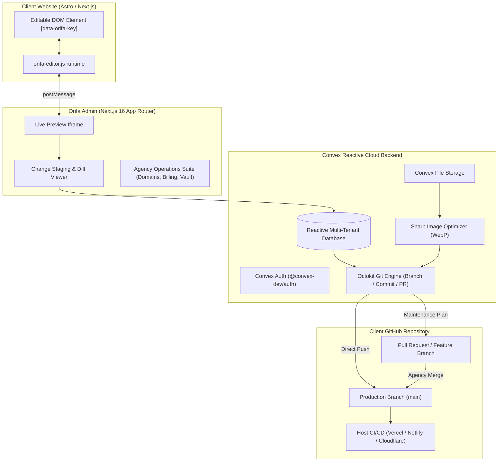

# Orifa Admin Platform

> **Visual GitOps Content Engine & Agency Operations Command Center**  
> Built by and for **Orifa Technologies** — empowering clients to visually manage website copy, assets, and articles with permanent GitHub commits and pull requests, paired with a unified agency maintenance suite.

---

## 🌟 Executive Overview

**Orifa Admin** is a proprietary multi-tenant platform designed to solve the two biggest operational hurdles faced by modern digital agencies:

1. **Non-Destructive Visual CMS for Static & Jamstack Sites**: Allows clients to click and visually edit copy, upload optimized WebP media, and write blog articles directly on websites built with **Astro, Next.js, and React**. Changes are permanently committed directly to **GitHub** (via automated Pull Requests or Direct Commits), preserving 100% static Core Web Vitals, SEO performance, and zero runtime database overhead on the client's site.
2. **Agency Operations & Client Vault Command Center**: Consolidates multi-client maintenance retainers, domain registration countdowns, third-party email workspace license renewals, and a zero-knowledge encrypted credential vault into a unified dashboard.

---

## ⚡ Key Platform Capabilities

### 1. Visual Click-to-Edit Runtime (`orifa-editor.js`)
- Embeddable lightweight script (`<script src=".../orifa-editor.js" ... defer></script>`) injected into client websites.
- Secure, token-authorized `postMessage` bridge between the Orifa Admin preview iframe and the client site.
- In-place hover inspection and inline rich editing targeting JSON data files (`src/content/*.json`) and Markdown files.

### 2. Configurable Dual-Mode Git Publishing
Tailored to client contract status:
- **Pull Request Review Workflow (`pull_request`)**: For clients **with** an active maintenance contract. Creates an automated feature branch (`orifa-update-[timestamp]`), commits content updates, and opens a GitHub Pull Request with a side-by-side diff summary table for agency review before merging.
- **Direct Commit to Production (`direct_commit`)**: For clients **without** a maintenance contract. Pushes changes directly to the target default branch (`main`), immediately triggering host CI/CD builds (e.g. Vercel, Netlify, Cloudflare Pages).

### 3. Media Pipeline & Sharp WebP Optimization
- File upload directly into Convex Cloud Storage.
- Serverless Node.js action powered by **Sharp** converts images into compressed, web-ready `.webp` (quality 82, maximum width 1920px).
- Commits the optimized binary WebP file directly to the client's GitHub repository under `public/images/uploads/`.

### 4. Blog & MDX Studio
- Rich markdown drafting workspace with automated YAML frontmatter extraction (title, slug, date, author, category, cover image, excerpt).
- Native compatibility with **Astro Content Collections** (`src/content/blog/*.md`) and Next.js MDX.

### 5. Agency Operations Suite
- **Multi-Tenant Organizations & RBAC**: Strict tenant isolation across `super_admin` (Orifa staff), `client_admin` (client owner), and `client_editor` (client staff).
- **Domain Expiration Monitors**: Real-time tracking of domains, registrars, and nameservers with automated expiration countdowns and alerts.
- **Retainer Subscriptions & Billing**: Monthly recurring revenue (MRR) tracking, contracted retainer hours, billing cycles, and overdue payment flags.
- **Email Workspace License Allocations**: Tracking Google Workspace, Microsoft 365, and Zoho license tiers, seat usage, renewal dates, and monthly costs.
- **Zero-Knowledge Encrypted Vault**: Browser-side **AES-256-GCM** encryption using PBKDF2 passphrase key derivation. Client credentials (API keys, DNS logins, database credentials) are encrypted before reaching the server, with complete audit logging.

---

## 🏗️ Architecture & Tech Stack



| Layer | Technology | Details |
|---|---|---|
| **Frontend Framework** | **Next.js 16.4.0** | App Router, Server & Client Components, Turbopack |
| **UI & Styling** | **Tailwind CSS v4** + **Lucide React** | Dark modern interface, clean responsive layouts |
| **Reactive Backend & DB** | **Convex Cloud** (`^1.46.0`) | Real-time queries, mutations, scheduled cron jobs |
| **Authentication & RBAC** | **Convex Auth** (`@convex-dev/auth`) | Multi-tenant session auth, role-based access control |
| **Git Automation** | **Octokit REST** (`@octokit/rest` v22) | Automated branches, file commits, PR diff summaries |
| **Image Processing** | **Sharp** (`^0.35.5`) | WebP transcoding and compression inside Convex Actions |
| **Client-Side Cryptography** | **Web Crypto API** | AES-256-GCM + PBKDF2 for Zero-Knowledge Vault |
| **Quality Gate & Tooling** | **Husky**, **lint-staged**, **Knip**, **Commitlint** | Pre-commit validation and Conventional Commits enforcement |
| **Release Management** | **Standard-Version** | Automated semantic versioning and changelog generation |

---

## 📁 Repository Structure

```
orifa-admin/
├── .husky/                       # Git hooks
│   ├── commit-msg                # Commitlint validator hook
│   └── pre-commit                # Typecheck, lint-staged & Knip quality gate
├── convex/                       # Convex Cloud Reactive Backend
│   ├── _generated/               # Auto-generated Convex API types
│   ├── actions/
│   │   ├── github.ts             # Octokit Git publishing (Direct Commit & PR Engine)
│   │   └── optimizeImage.ts      # Sharp WebP image processing
│   ├── lib/
│   │   └── auth.ts               # Multi-tenant RBAC assertions & helpers
│   ├── auth.ts                   # Convex Auth configuration
│   ├── blog.ts                   # Blog posts queries & mutations
│   ├── crons.ts                  # Scheduled domain expiration monitors
│   ├── domains.ts                # Domain tracking & status queries
│   ├── emailLicenses.ts          # Google Workspace & M365 license management
│   ├── http.ts                   # HTTP routers for external webhook endpoints
│   ├── media.ts                  # Media asset registration & upload endpoints
│   ├── organizations.ts          # Tenant organization CRUD
│   ├── projects.ts               # Website projects & Git credentials
│   ├── schema.ts                 # Strict Convex database schema
│   ├── stagedChanges.ts          # Change staging queue & approval logic
│   ├── subscriptions.ts          # Maintenance retainers & MRR tracking
│   ├── users.ts                  # User accounts & roles
│   └── vault.ts                  # Zero-knowledge encrypted credential vault
├── docs/                         # Architecture & guides
│   ├── ARCHITECTURE.md           # In-depth architectural blueprint
│   └── EXTERNAL_RESOURCES.md     # External accounts, credentials & setup guide
├── public/
│   └── orifa-editor.js           # Client-side visual click-to-edit runtime
├── src/
│   ├── app/
│   │   ├── (dashboard)/          # Authenticated agency & CMS dashboard
│   │   │   ├── billing/          # Retainers & MRR management
│   │   │   ├── changes/          # Global staged changes queue
│   │   │   ├── domains/          # Domain monitor & countdowns
│   │   │   ├── licenses/         # Email workspace license tracker
│   │   │   ├── organizations/    # Client organizations management
│   │   │   ├── projects/         # Website projects & configuration
│   │   │   │   └── [id]/         # Project-specific submodules (Blog, Changes, Media, Preview)
│   │   │   └── vault/            # Encrypted client credentials vault
│   │   ├── signin/               # Authentication portal
│   │   ├── ConvexClientProvider.tsx # Reactive Convex client provider
│   │   ├── layout.tsx            # Global dashboard layout
│   │   └── page.tsx              # Landing / portal overview
│   └── components/               # Reusable UI & layout components
├── .versionrc.json               # Semantic versioning & changelog format
├── commitlint.config.js          # Conventional commit message validation rules
├── knip.json                     # Unused dependencies, exports & files detector
├── eslint.config.mjs             # Next.js flat ESLint configuration
└── package.json                  # NPM scripts & dependencies
```

---

## 🚀 Getting Started

### Prerequisites
- **Node.js**: `20.x` or higher
- **npm**: `10.x` or higher
- **Convex Account**: Free account on [convex.dev](https://convex.dev)
- **GitHub Account & PAT**: With repository `Contents` and `Pull requests` read/write permissions.

### 1. Clone & Install Dependencies
```bash
git clone https://github.com/orifatech/orifa-admin.git
cd orifa-admin
npm install
```

### 2. Configure Environment Variables
Create `.env.local` in the project root:
```env
# Deployment identifier used by Convex CLI
CONVEX_DEPLOYMENT=dev:your-deployment-name

# Public WebSocket URL for reactive queries
NEXT_PUBLIC_CONVEX_URL=https://your-deployment-name.convex.cloud

# Public HTTP URL for Auth actions and webhooks
NEXT_PUBLIC_CONVEX_SITE_URL=https://your-deployment-name.convex.site
```

In your **Convex Dashboard** (Settings → Environment Variables), configure:
- `GITHUB_TOKEN`: Your GitHub Personal Access Token (Fine-grained PAT with `Contents: Read/Write` and `Pull requests: Read/Write`).
- `SITE_URL`: `http://localhost:3000` (in development) or your production domain (e.g. `https://admin.orifatech.com`).

*For full details on accounts and permissions, see [`docs/EXTERNAL_RESOURCES.md`](docs/EXTERNAL_RESOURCES.md).*

### 3. Start Development Servers
Run the Convex backend watcher in one terminal:
```bash
npx convex dev
```

In a second terminal, start the Next.js development server:
```bash
npm run dev
```

Open [http://localhost:3000](http://localhost:3000) in your browser.

---

## 🔌 Client Website Integration

To enable visual in-place editing on any client Astro, Next.js, or HTML site:

### 1. Add the Script
Embed the lightweight script in the client website `<head>` or before `</body>`:
```html
<script 
  src="https://<YOUR-ORIFA-ADMIN-DOMAIN>/orifa-editor.js" 
  data-orifa-token="<PROJECT_EDITOR_SECRET_TOKEN>" 
  data-orifa-endpoint="https://<YOUR-ORIFA-ADMIN-DOMAIN>" 
  defer>
</script>
```
*(The `editorSecretToken` is automatically generated when you create a project in Orifa Admin).*

### 2. Tag Editable DOM Elements
Add the `data-orifa-key` and `data-orifa-file` attributes to any editable text or image tag:
```html
<!-- Content JSON Example -->
<h1 data-orifa-key="hero.title" data-orifa-file="src/content/home.json">
  Building the Future of Web
</h1>

<!-- Image Replacement Example -->

```

When viewed inside the Orifa Admin preview iframe, client editors can click any tagged element, edit copy, upload images, and stage their updates for review.

---

## 🛡️ Developer Workflow & Quality Gate

Orifa Admin maintains strict code quality and release standards enforced via automated git hooks:

### Available NPM Scripts

| Script | Purpose |
|---|---|
| `npm run dev` | Starts Next.js development server with Turbopack |
| `npm run build` | Compiles production Next.js application |
| `npm run typecheck` | Validates TypeScript types across Next.js and Convex (`tsc --noEmit`) |
| `npm run lint` | Runs Next.js ESLint rules |
| `npm run check:unused` | Runs Knip to detect unused dependencies, dead code, and orphaned exports |
| `npm run release` | Runs standard-version to bump version, generate `CHANGELOG.md`, and tag release |
| `npm run release:patch` | Bump patch version (`0.1.0` -> `0.1.1`) |
| `npm run release:minor` | Bump minor version (`0.1.0` -> `0.2.0`) |
| `npm run release:major` | Bump major version (`0.1.0` -> `1.0.0`) |

### Pre-Commit Quality Gate
On every `git commit`, Husky runs:
1. `npm run typecheck`: Validates full TypeScript compile.
2. `npx lint-staged`: Runs `eslint --fix` on staged files.
3. `npm run check:unused`: Knip scans for dead code and missing dependencies.

### Commit Message Linting
Commits must follow the **Conventional Commits** specification:
```bash
# Correct examples:
git commit -m "feat(projects): add maintenance contract publishing selector"
git commit -m "fix(vault): correct clipboard toast timeout"
git commit -m "docs: update external credentials guide"

# Rejected example:
git commit -m "update stuff" # (Husky will reject this commit)
```

---

## 🌐 Production Deployment

### 1. Convex Backend Deployment
```bash
npx convex deploy
```
This deploys your database schema, mutations, and actions to the production Convex environment and outputs your production URLs.

### 2. Frontend Hosting (Vercel / Netlify / Cloudflare Pages)
Connect your GitHub repository to your preferred hosting provider:
- **Framework Preset**: `Next.js`
- **Build Command**: `npm run build`
- **Output Directory**: `.next`
- **Environment Variables**:
  - `NEXT_PUBLIC_CONVEX_URL`: Your production Convex URL (`https://<prod-deployment>.convex.cloud`)
  - `NEXT_PUBLIC_CONVEX_SITE_URL`: Your production Convex site URL (`https://<prod-deployment>.convex.site`)

---

## 📄 License & Proprietary Notice

Copyright © 2026 **Orifa Technologies**. All rights reserved.  
This software is proprietary and confidential. Unauthorized copying, distribution, or modification of this codebase, via any medium, is strictly prohibited without explicit written permission from Orifa Technologies.
