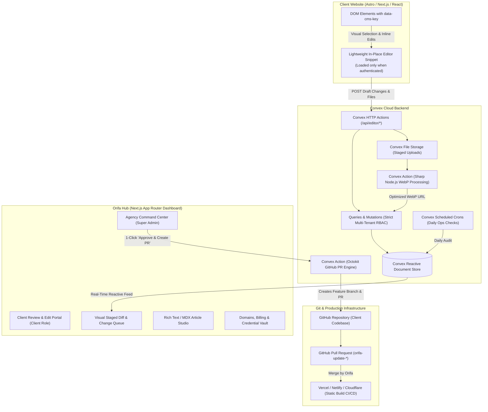

# Orifa Technologies Platform: Architecture & Module Specification

## 1. Executive Summary & System Vision

### 1.1 Objective
The **Orifa Hub** is a proprietary internal platform built by and for **Orifa Technologies**. It serves two tightly integrated purposes:
1. **Visual Website Content Engine**: Empowers clients to visually click, edit copy, upload images, and author blog articles on websites built with **React, Next.js, and Astro**, while permanently staging and committing these changes directly to **Git repositories** via **GitHub Pull Requests** (preserving 100% static SEO, Core Web Vitals, and zero runtime overhead).
2. **Agency Operations & Client Vault**: Consolidates multi-client maintenance retainers, domain registration monitoring, third-party email workspace renewals, and an encrypted client credential vault into a unified command center.

### 1.2 Architectural Decision: Convex as the Unified Backend
Rather than orchestrating separate database, storage, cron, and queue services (e.g. Supabase + Redis + BullMQ), **Convex** provides a single reactive TypeScript backend:
- **Reactive Data Engine**: Automatic real-time UI synchronization when clients submit edits, upload media, or when deployments finish.
- **Unified TypeScript Schema**: Strict compile-time and runtime validation across all mutations, queries, and HTTP endpoints.
- **Convex Actions (Node.js)**: Runs heavy I/O operations directly (e.g. `@octokit/rest` for GitHub commits/PRs, `sharp` for WebP conversion, WHOIS/RDAP lookups for domains).
- **Built-in File Storage**: Zero-setup staging storage for uploaded client media before pushing to Git.
- **Built-in Cron Scheduler**: Executes daily checks for domain expirations, subscription renewals, and email license deadlines without external infrastructure.
- **Convex Auth**: Native multi-tenant authentication with role-based access control (`super_admin`, `client_admin`, `client_editor`).

---

## 2. System Architecture & Data Flow

---

## 3. Detailed Module Specifications

### Module 1: Multi-Tenancy & Access Control (RBAC)
- Roles: `super_admin` (Orifa staff), `client_admin` (Client owner), `client_editor` (Client staff).
- Strict database-level isolation: every project and staged change is scoped to an `organizationId`.
- Powered by Convex Auth (`@convex-dev/auth`) using Password and Magic Link/Email providers.

### Module 2: Visual In-Place Editor Runtime & Client Snippet
- Standalone client script (`orifa-editor.js`).
- Highlights DOM elements matching `[data-cms="file.key"]`.
- In-page floating toolbar for text editing, styling, and image replacement.
- PostMessage bridge with origin verification and signed HMAC/token checks.

### Module 3: Change Staging Queue & Visual Diff Viewer
- Side-by-side diffing of proposed values vs current values.
- Lifecycle: `draft` -> `pending_review` -> `approved` -> `pr_created`.
- Batch grouping of multiple edits into release bundles.

### Module 4: Media Pipeline & WebP Optimization Engine
- Uploads images to Convex file storage.
- Sharp action in Node.js runtime converts images to `.webp` (quality 82, max width 1920px).
- Stores optimized WebP ready for GitHub repository commit to `public/images/uploads/`.

### Module 5: Git Pull Request Automation Engine
- Powered by `@octokit/rest`.
- Automatically checks out new branch `orifa-update-[timestamp]`.
- Updates JSON content files (`src/content/*.json`), Markdown files (`src/content/blog/*.md`), and writes binary WebP images.
- Creates a Pull Request with a formatted markdown summary table of all staged changes.

### Module 6: Blog & Rich Content Management
- Dedicated article studio using Tiptap / rich-text editor.
- Frontmatter controls (title, slug, author, pubDate, category, tags, SEO meta, cover image).
- Outputs Markdown compatible with Astro Content Collections (`src/content/blog/*.md`) and Next.js MDX.

### Module 7: Agency Operations Command Center
- **7A. Domain Expiration Monitor**: Daily cron job running RDAP/WHOIS checks; alerts at 60, 30, and 7 days.
- **7B. Maintenance & Retainer Tracker**: Monthly recurring fee, billing cycle, overdue flags, and MRR dashboard.
- **7C. Email Workspace License Tracker**: Provider (Google/Microsoft/Zoho), seat count, renewal dates, and renewal alerts.
- **7D. Encrypted Credential Vault**: AES-256-GCM authenticated encryption at rest for client logins, cPanel, registrar, and API keys with audit logging.
